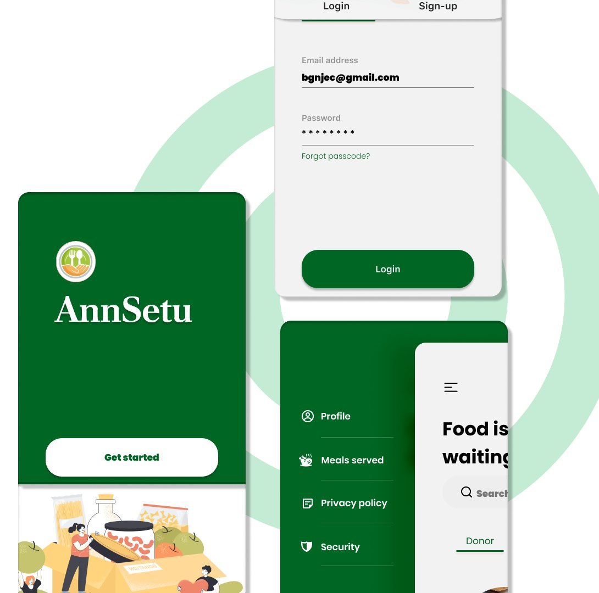
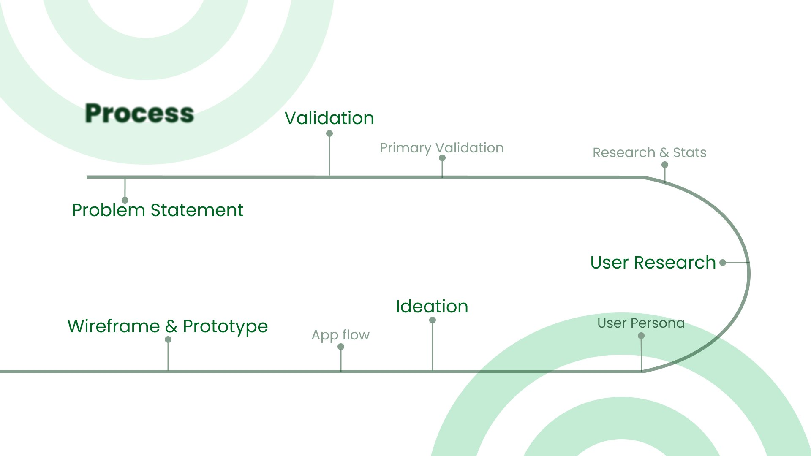
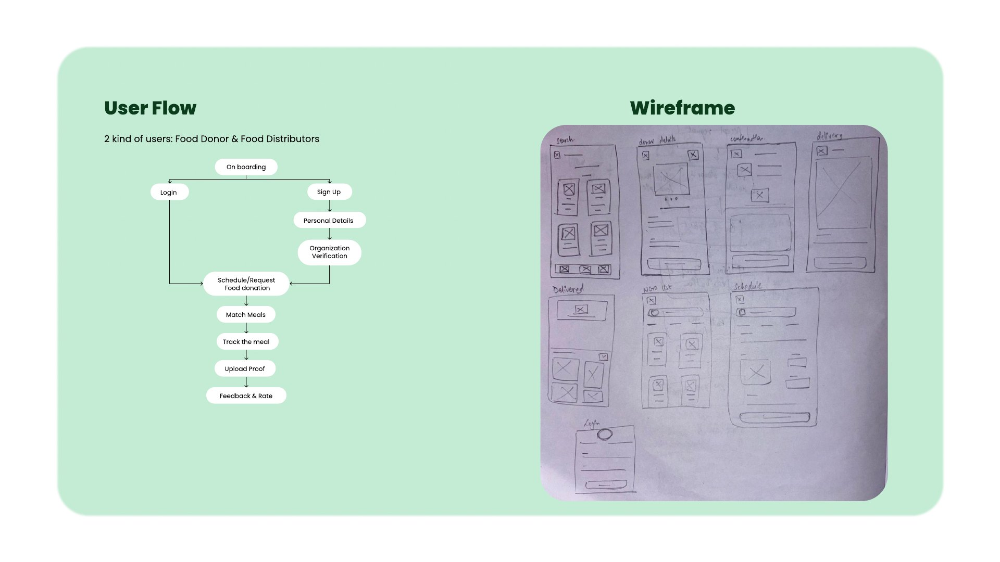
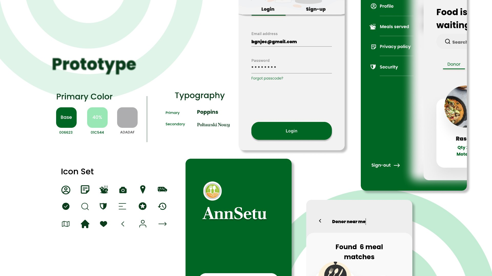
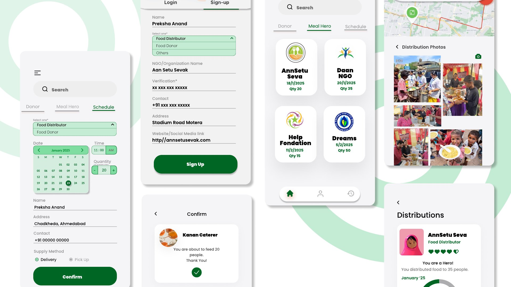
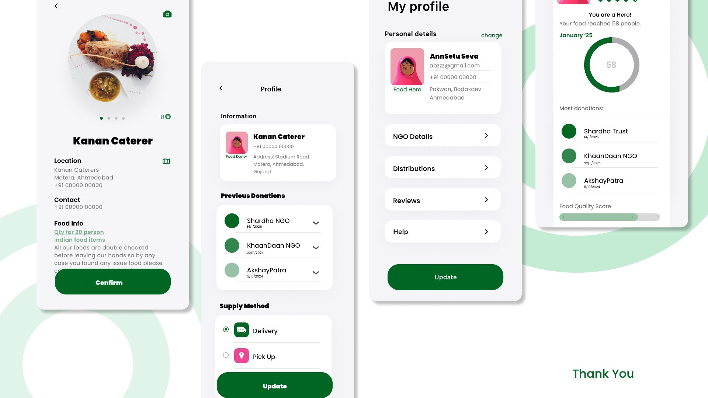

# Ann Setu – Food Bridge 🍲🌉

**Ann Setu** (*"food bridge"*) is a mobile app that creates a seamless bridge between **food providers** (event caterers, restaurants) and **food distributors** (NGOs, volunteers) to ensure surplus food reaches the needy instead of being wasted.

**Self Project · 1 Month · UI/UX Design**

🌐 **[View the case study website](https://preksha-05.github.io/Ann-Setu/)**

---

## Problem statement

> "A significant amount of food from weddings and large events goes to waste, while many people struggle with hunger. There is a need for a streamlined, reliable system that connects event caterers with NGOs to efficiently donate and distribute surplus food to those in need."

### Research

| | |
|---|---|
| **30%** food wastage in weddings | Food served at weddings often goes uneaten due to over-preparation, buffet culture, social pressure, fear of scarcity, and lack of planning. |
| **27.3** Global Hunger Index score | India ranks 105th out of 127 countries with sufficient data to calculate GHI scores, a "serious" level of hunger. |
| **224 million** undernourished people | According to the UN Food and Agriculture Organization, about 224 million undernourished people were living in India as of 2021. |

### Solution

**AnnSetu app:** real-time food donation requests, a smart matching algorithm, a volunteer network, food safety compliance, and recognition & incentives.

---

## Process

Problem Statement → Validation → Primary Validation → Research & Stats → User Research → User Persona → Ideation → App Flow → Wireframe & Prototype

---

## User personas

| | 🍽️ Ravi Mehta, 43 – Owner of Mehta Caterer | 🤝 Anita Sharma, 35 – Volunteer at an NGO |
|---|---|---|
| **Goals** | • Reduce food waste while ensuring sufficient supply • Maintain consistent taste & hygiene standards | • Find consistent food donors to serve more needy people • Ensure timely pickup & delivery to prevent food spoilage |
| **Pain points** | • Food with short shelf life has to be consumed in 2–3 days • No consistent place for donating the food • Proof of distribution amongst the needy, if food is donated | • Food quality and hygiene • No easy way to find food donations • Struggles with transportation • Uncertainty about the food quantity |

---

## Features & specifications

**User registration**
- Role-based sign-up (Caterer/Restaurant, NGO, Volunteer)
- Business verification for food providers
- NGO verification to ensure legitimacy
- Profile management (edit info, donation history, ratings)

**Food donation & requests**
- Food providers can list available food with type, quantity, expiry time and storage requirements
- NGOs can browse & request donations
- AI-powered matching that auto-connects NGOs with nearby food providers
- Scheduled & instant donations based on need

**Food safety & quality control**
- Automated food safety checklist before listing
- NGO approval system to accept or reject food based on quality
- Food condition ratings & feedback for transparency

**Location & delivery**
- Volunteer matching system that assigns the nearest available volunteer
- Real-time tracking so NGOs & donors can follow pickup & delivery
- Live notifications & alerts for all users
- Delivery & pick-up modes

**AI-powered smart insights**
- Predictive analytics that suggest donation frequency based on past behaviour

**Recognition**
- Badges & rewards for top donors & volunteers

---

## User flow & wireframes

There are two kinds of users: **Food Donors** and **Food Distributors**.

Onboarding → Login / Sign Up (Personal Details → Organization Verification) → Schedule/Request Food Donation → Match Meals → Track the Meal → Upload Proof → Feedback & Rate

---

## Style guide

| Colour | Hex |
|---|---|
| Base | `#006623` |
| Accent (40%) | `#01C544` |
| Neutral | `#ADADAF` |

**Typography:** Poppins (primary) · Poltawski Nowy (secondary)

---

## Final screens

---

## Tools

Figma

## Designer

**Preksha Anand**
